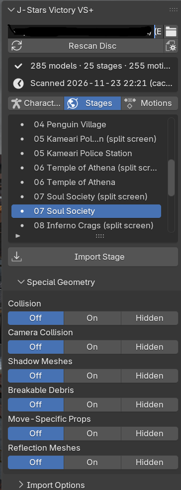

# J-Stars Victory VS+ Importer for Blender 5.2

Imports characters, skeletons, motions, materials, textures and stages directly from **your own** J-Stars Victory VS+ (PS3) disc image. No game data is included in this repository.

> [!NOTE]
> This project can be considered a companion to the work done in [jsp-vs-ex](https://github.com/Tsamiuy/jsp-vs-ex). Its notes on the game's container formats ($CMP, STPK, CPK layout) are the groundwork this importer builds on.

## Examples

| Character import (Boa Hancock, idle motion) | Stage import (Soul Society) |
|---|---|
|  |  |

## Install

1. Build the package (or use `dist/jstars_importer-1.0.2.zip`):
   ```
   "D:\Blender Foundation\Blender 5.2\blender.exe" --command extension build --source-dir jstars_importer --output-dir dist
   ```
2. In Blender: **Edit › Preferences › Get Extensions › ▾ › Install from Disk…** and pick the zip.

## Use

1. **3D View › Sidebar (N) › J-Stars**: set the disc (`.iso`, or an extracted folder containing `PS3_GAME`) and press **Scan Disc**. The scan runs in the background with a progress bar (about 20–25 s; Esc or ✕ cancels) and writes a small index (~300 KB) to the extension's user folder. That index is reloaded automatically after Blender restarts, File › New, or opening another file, so you only scan once. Use **Rescan Disc** if the disc moves or changes; the panel warns when it has.
2. **Characters**: filter by kind (Battle, J-Adventure, Support, World Map), pick a model and choose **Import Character**: *Model Only*, *+ Idle* or *+ All Motions* of the character's fighter set.
3. **Motions**: select an imported armature (or one of its meshes). With *Only sets for the active character* on, the list shows that character's motion sets. **Import Motion** imports one motion and **Whole Set** imports every motion in the set, each as an Action.
4. **Stages**: pick a stage (normal, split-screen or gimmick part) and choose **Import Stage**.
5. **File › Import › J-Stars Victory VS+ (.srd/.san)** imports loose extracted files. An `.srd` needs its `.srdi` / `.srdv` beside it, and textures are taken from `*_texture.srd` files in the same folder. A `.san` goes onto the selected armature.

The *Import Options* sub-panel (also in the add-on preferences) sets the texture mode (direct DDS or NumPy decode), Z-up conversion, scale, bone display length, stage prop instancing, stage shader rebuilding and stage water. It also has **Open Cache Folder** and **Clear Cache**.

<p align="center"><br><em>The J-Stars sidebar panel after a scan, with the Stages tab open.</em></p>

### Special geometry (Preferences, or the *Special Geometry* sub-panel)

Each category can be **Off** (default), **On**, or **Hidden**. *Hidden* imports the geometry into its own collection with viewport (eye) and render visibility turned off.

| Category | What it is |
|---|---|
| Collision | `$COL` collision hulls (ground, walls, breakable-object hulls) |
| Camera Collision | Volumes the camera is kept out of |
| Shadow Meshes | Fake/blob shadow geometry (`shadow`, `shd`, `sdw`, `sdo`, `*_sha` parts, shadow materials, stage meshes whose shader outputs lighting only) |
| Breakable Debris | Stage `knock`/`scatter` break-apart templates and the broken state of placed props |
| Move-Specific Props | Character `bind_equipment` props shown only during certain moves |
| Reflection Meshes | Planet Namek's terrain copies (`UMIREF` materials) that the game draws only into the water reflection; they overlap the real terrain |

## More documentation

- [How the importer works](docs/IMPLEMENTATION.md): disc index, character, mesh, texture, motion, stage and shader import, axes, and the custom properties written on import
- [Data formats](docs/FORMATS.md): containers, SRD blocks, RSX shaders, motions, stage layout. Container formats ($CMP, STPK, CPK layout) build on the notes of the [jsp-vs-ex](https://github.com/Tsamiuy/jsp-vs-ex) project.
- [Accuracy checks done](docs/ACCURACY.md), and how to run the tests
- [Known limitations](docs/LIMITATIONS.md)
- [Round-tripping](docs/ROUNDTRIP.md): design for an exporter that writes edited Blender data back to the game's formats (not implemented yet)
